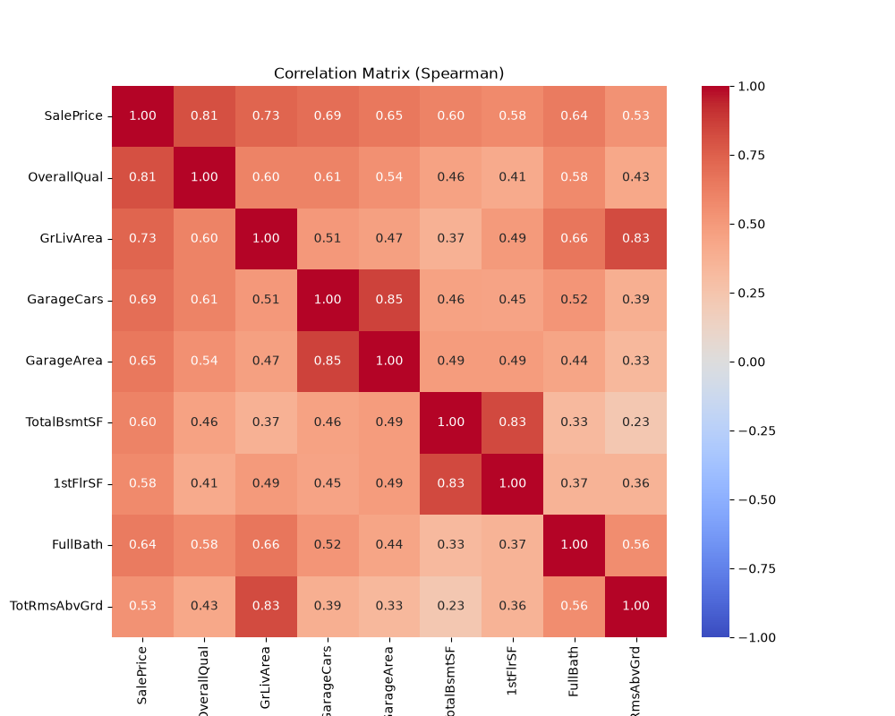

# Dissecting a Housing Market: A Mathematical EDA Framework Built from First Principles

## Project Summary

An end-to-end exploratory data analysis of the **Ames Housing dataset** (1,460 homes × 81 features), taking the data from raw and incomplete to cleaned, understood, and modelling-ready. The notebook performs a domain-aware data-quality audit, then studies the target `SalePrice` and its strongest drivers through descriptive statistics, distribution analysis, and bivariate correlation — narrating the *why* behind every statistical choice rather than just producing plots.

## Project Status

**Work in progress.** This project is being built as a series of notebooks that walk through statistics and machine learning from first principles, each layering on the previous one. Notebook `01` (exploratory data analysis) is almost complete; the following five are planned:

| Notebook                             | Focus                                                     |
|--------------------------------------|-----------------------------------------------------------|
| `01_exploratory_data_analysis`       | Data cleaning, univariate & bivariate EDA                 |
| `02_data_and_sampling_distributions` | Sampling, the bootstrap, sampling distributions & the CLT |
| `03_experiments_and_testing`         | Hypothesis testing, A/B testing, significance             |
| `04_regression_and_prediction`       | Linear & multiple regression, prediction                  |
| `05_classification`                  | Classification models & evaluation                        |
| `06_statistical_ml`                  | Statistical machine learning methods                      |

## Key Findings

- **`SalePrice` is strongly right-skewed.** Mean = \$180,921 but median = \$163,000, and the 10% trimmed mean (\$170,783) sits below the mean — high-end sales pull the average up. A `log1p` transform renders the distribution approximately normal and modelling-friendly.
- **Prices are concentrated and long-tailed.** The middle 50% of homes sold between \$129,975 and \$214,000 (IQR = \$84,025), while only 4 of 1,460 homes exceeded \$466,960.
- **Overall quality dominates.** `OverallQual` is the single strongest predictor (Pearson *r* = 0.79), followed by living area `GrLivArea` (0.71), `GarageCars` (0.64), `GarageArea` (0.62), `TotalBsmtSF` (0.61), and `1stFlrSF` (0.61).
- **Predictors are collinear with each other.** `GarageCars`/`GarageArea` and `TotalBsmtSF`/`1stFlrSF` each measure overlapping information — relevant for any downstream regression model.
- **Most "missing" data isn't missing.** Of the columns with nulls, the majority (e.g. `PoolQC`, `Alley`, basement/garage fields) encode *absence of the feature*, not lost records; only `LotFrontage` (259 nulls) and `Electrical` (1 null) required genuine imputation.

## Mathematical Concepts Implemented from Scratch

- **Central tendency & robustness** — mean, median, and 10% trimmed mean compared side by side to quantify skew.
- **Dispersion via order statistics** — percentiles (5/25/50/75/95) and the interquartile range, visualised with a boxplot.
- **Distribution shape** — skewness coefficients annotated on each histogram, and a `log1p` variance-stabilising transform.
- **Correlation** — Pearson (linear) and Spearman (monotonic rank) matrices, used together to separate linear from non-linear association.
- **Ordinary least squares fit line** — regression slope/intercept computed with `numpy.polyfit` and overlaid on scatter plots, with the correlation coefficient `r` labelled per feature.
- **Group-wise median imputation** — `LotFrontage` filled with the median of its own `Neighborhood` to preserve local distribution.

## Visualizations

|                                                                                                     |                                                                                                    |
|-----------------------------------------------------------------------------------------------------|----------------------------------------------------------------------------------------------------|
|                     |                |
|  |            |
|               |           |
|     |  |

## How to Run

```bash
# 1. Install dependencies (Python 3.13 recommended)
pip install -r requirements.txt

# 2. Launch the notebook
jupyter notebook notebooks/01_exploratory_data_analysis.ipynb
```

Run the cells top to bottom. The dataset is fetched automatically via `sklearn.datasets.fetch_openml`, so no manual download is needed. The notebook writes the cleaned dataset to `data/cleaned_data.csv` and saves all figures to `figures/`. Paths are relative to the `notebooks/` directory, so run it from there (the default for Jupyter).

## Dataset

The **Ames Housing dataset** describes residential property sales in Ames, Iowa (2006–2010): 1,460 records with 79 explanatory features (plus `Id` and target `SalePrice`) spanning lot geometry, quality/condition ratings, room counts, garage and basement details, and sale circumstances. Loaded via OpenML (`fetch_openml(name='house_prices')`). See `data_description.txt` for the full data dictionary.

## Skills Demonstrated

- Domain-aware **data cleaning** and a three-way missing-value strategy (categorical → `"None"`, numeric → `0`, genuine gaps → group median / mode)
- **Descriptive & inferential statistics** applied and interpreted, not just computed
- **Distribution diagnostics** and transformation (skewness, log transform)
- **Feature selection** by correlation strength and by covering distinct property domains (location, design, transaction, zoning)
- **Data visualization** with matplotlib and seaborn (histograms, boxplots, KDE, heatmaps, annotated scatter grids)
- Clear **analytical storytelling** in a reproducible notebook workflow
