# Anatomy of a Housing Market: From Raw Data to Predictive Models

## Project Summary

A multi-notebook project on statistics and machine learning, built around the Ames Housing dataset as a running case study. It moves end to end: from raw data through sampling, hypothesis testing, regression, and classification. Each notebook builds on the one before it, and every decision is explained, not just applied.

## Project Status

**Work in progress.** This project is being built as a series of notebooks that walk through statistics and machine learning from first principles, each layering on the previous one. Notebook `01` is complete; notebook `02` is in progress (sampling, bootstrap, and QQ-plot diagnostics are in, but the notebook is not yet considered final); the following four are planned:

| Notebook                             | Focus                                                     | Status   |
|--------------------------------------|-----------------------------------------------------------|----------|
| `01_exploratory_data_analysis`       | Data cleaning, univariate & bivariate EDA                 | Complete |
| `02_data_and_sampling_distributions` | Sampling, the bootstrap, sampling distributions & the CLT | Ongoing  |
| `03_experiments_and_testing`         | Hypothesis testing, A/B testing, significance             | Planned  |
| `04_regression_and_prediction`       | Linear & multiple regression, prediction                  | Planned  |
| `05_classification`                  | Classification models & evaluation                        | Planned  |
| `06_statistical_ml`                  | Statistical machine learning methods                      | Planned  |

## Key Findings

### From notebook 01 — exploratory data analysis

- **`SalePrice` is strongly right-skewed.** Mean = \$180,921 but median = \$163,000, and the 10% trimmed mean (\$170,783) sits below the mean — high-end sales pull the average up. A `log1p` transform renders the distribution approximately normal and modelling-friendly.
- **Prices are concentrated and long-tailed.** The middle 50% of homes sold between \$129,975 and \$214,000 (IQR = \$84,025), while only 2 of 1,460 homes exceeded \$682,990.
- **Overall quality dominates.** `OverallQual` is the single strongest predictor (Pearson *r* = 0.79), followed by living area `GrLivArea` (0.71), `GarageCars` (0.64), `GarageArea` (0.62), `TotalBsmtSF` (0.61), and `1stFlrSF` (0.61).
- **Predictors are collinear with each other.** `GarageCars`/`GarageArea` and `TotalBsmtSF`/`1stFlrSF` each measure overlapping information — relevant for any downstream regression model.
- **Most "missing" data isn't missing.** Of the columns with nulls, the majority (e.g. `PoolQC`, `Alley`, basement/garage fields) encode *absence of the feature*, not lost records; only `LotFrontage` (259 nulls) and `Electrical` (1 null) required genuine imputation.

### From notebook 02 — data and sampling distributions

- **The sampling distribution of the mean becomes normal as *n* grows.** Even though `SalePrice` is heavily right-skewed, the distribution of the sample mean is approximately normal by `n = 30` and tightly normal by `n = 100` — a clean visual demonstration of the Central Limit Theorem.
- **Empirical standard error matches the theoretical `s/√n`.** For each of `n ∈ {5, 30, 100}`, the standard deviation of 1,000 simulated sample means sits on top of the theoretical curve, confirming the simulation reproduces the analytical result.
- **Standard error shrinks with sample size, as expected.** Larger `n` gives a smaller SE, which is why the histograms for `Mean of 30` and `Mean of 100` are visibly narrower than `Mean of 5` (or the raw data).
- **Small Monte Carlo gaps are unavoidable.** Each empirical SE is itself an estimate built from 1,000 simulated means, so it differs from theory by a small random amount. Pushing the simulation count to 10,000 or 100,000 would tighten that agreement further.
- **The sample median is essentially unbiased for `SalePrice`.** From 10,000 bootstrap resamples of size 1,460, the bootstrap median (\$162,909.42) sits within \$91 of the observed median (\$163,000), giving a bias of −\$90.58 (−0.06%), which is well within sampling noise.
- **The bootstrap SE of the median is ≈ \$2,363.** This is the standard deviation of the bootstrap distribution, used as a Monte Carlo estimate of the standard error of the median (no closed-form SE exists for the sample median).
- **The 95% bootstrap percentile CI for the median is \$158,900 – \$167,500.** Taken from the 2.5th and 97.5th percentiles of the 10,000 bootstrap medians, this gives a non-parametric uncertainty band for the central price level.
- **The bootstrap distribution is multimodal.** The histogram of bootstrap medians shows several distinct peaks rather than a smooth bell curve, which is expected — the median is a discrete statistic on dollar values, so many bootstrap samples produce identical medians.
- **`SalePrice` is visibly non-normal on a QQ-plot.** A normal QQ-plot of the raw prices follows the reference line through the bulk of the data but pulls sharply above it in the upper tail, confirming the right skew and heavy upper tail seen in the histogram.
- **`log1p(SalePrice)` is much closer to normal.** The same QQ-plot on `log1p(SalePrice)` hugs the reference line end to end, with only minor deviations in the lower and upper tails — quantitative evidence that the log transform is the right variance-stabilizer for downstream modelling.

## Mathematical Concepts Implemented

### Notebook 01

- **Central tendency & robustness** — mean, median, and 10% trimmed mean compared side by side to quantify skew.
- **Dispersion via order statistics** — percentiles (5/25/50/75/95) and the interquartile range, visualised with a boxplot.
- **Distribution shape** — skewness coefficients annotated on each histogram, and a `log1p` variance-stabilising transform.
- **Correlation** — Pearson (linear) and Spearman (monotonic rank) matrices, used together to separate linear from non-linear association.
- **Ordinary least squares fit line** — regression slope/intercept computed with `numpy.polyfit` and overlaid on scatter plots, with the correlation coefficient `r` labelled per feature.
- **Bivariate density estimation** — hexagonal binning (`hexbin`) and kernel density contours (`kdeplot`) used to expose overplotting that a scatter plot hides once predictors get dense.
- **Categorical-vs-numeric distribution** — violin plot of `SalePrice` grouped by `OverallQual` with inner quartiles to compare both spread and central tendency per group.
- **Group-wise median imputation** — `LotFrontage` filled with the median of its own `Neighborhood` to preserve local distribution.

### Notebook 02

- **Monte Carlo simulation** — 1,000 independent resamples of `SalePrice` and 1,000 resample-means at each of three sample sizes (5, 30, 100), all assembled into one long DataFrame and faceted with `sns.FacetGrid`.
- **Central Limit Theorem, demonstrated** — side-by-side histograms of the raw data and three sampling distributions of the mean, showing the distribution converging to normal and shrinking in width as *n* grows.
- **Empirical standard error** — the standard deviation of the 1,000 simulated sample means at each `n`, used as a Monte Carlo estimate of `SE(x̄)`.
- **Theoretical standard error** — `s/√n` with `s` taken as the sample standard deviation of the raw `SalePrice` column.
- **Empirical vs. theoretical SE comparison** — line plot overlaying both curves over the same *n* axis, so the simulation can be checked against the analytical result.
- **Skewness interpretation** — qualitative reading of histogram shape at each *n* to argue for normality of the sampling distribution even when the underlying data is strongly skewed.
- **Bootstrap resampling** — `R = 10,000` samples of size `n = 1,460` drawn with replacement from the observed `SalePrice` column, used to estimate the sampling distribution of a statistic (here the median) for which no closed-form standard error exists.
- **Bootstrap bias** — difference between the mean of the bootstrap distribution and the observed statistic, computed and reported in dollars to quantify estimator bias relative to the scale of the data.
- **Bootstrap standard error** — the standard deviation of the 10,000 bootstrap medians, used as a Monte Carlo standard error for the sample median.
- **Percentile bootstrap confidence interval** — the 2.5th and 97.5th percentiles of the bootstrap distribution taken as the lower and upper bounds of a 95% CI for the median.
- **Distribution shape interpretation** — explaining the multimodal bootstrap histogram as a consequence of the discrete dollar values of `SalePrice` (many bootstrap samples produce identical medians), rather than treating it as a violation of normality.
- **Z-score standardization** — `scipy.stats.zscore` applied to `SalePrice` to produce a unit-variance series (verified mean ≈ 0, std ≈ 1), as a precursor to QQ-plot diagnostics against the standard normal.
- **Normal QQ-plot** — `scipy.stats.probplot` against a normal reference distribution, used to read off deviations from normality in the bulk and the tails. The raw `SalePrice` QQ-plot exposes the heavy upper tail as a clean upward bend in the rightmost points.
- **Transform-and-compare** — repeating the QQ-plot on `log1p(SalePrice)` to quantify how much the log transform repairs the upper-tail deviation, separating "skewed but linear in the middle" from "approximately normal end to end."

## Few Visualizations

### Notebook 01

|                                                                                                          |                                                                                                          |
|----------------------------------------------------------------------------------------------------------|----------------------------------------------------------------------------------------------------------|
| 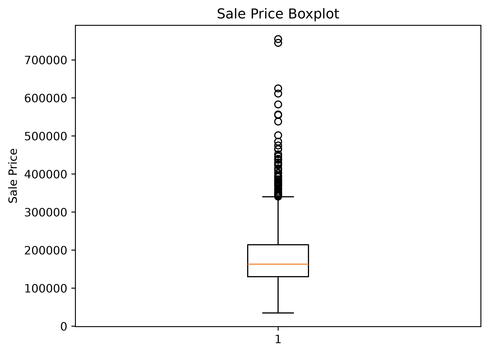                        | 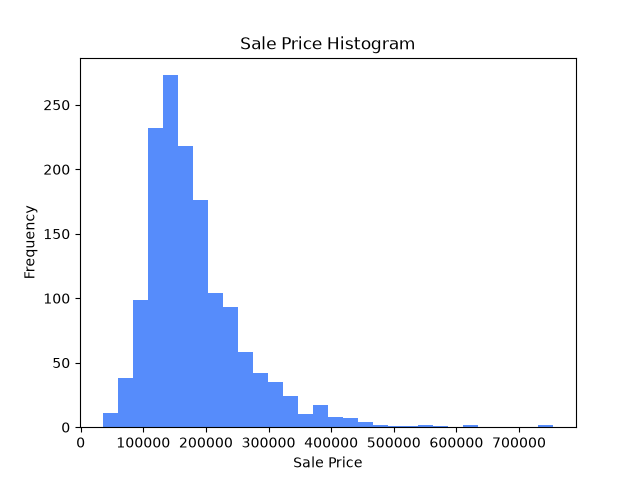                     |
| 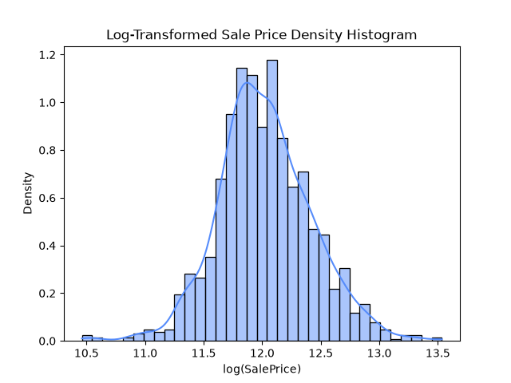     | 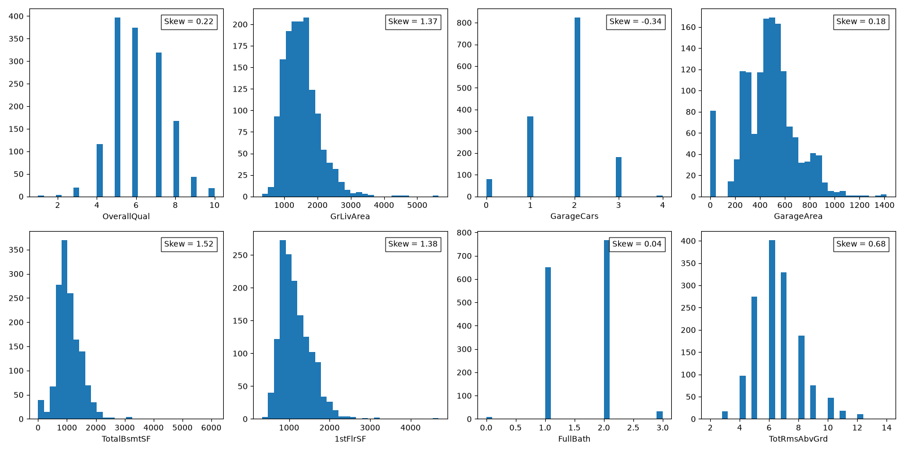                 |
| 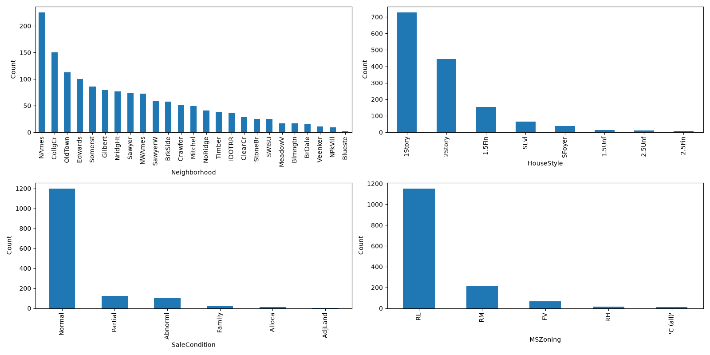                  | 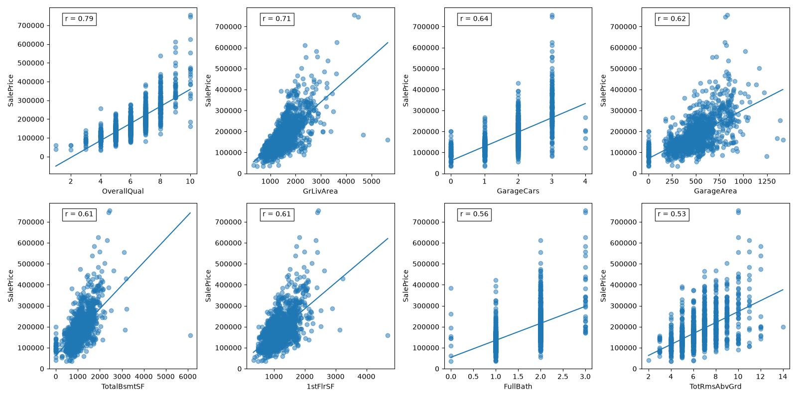                |
| 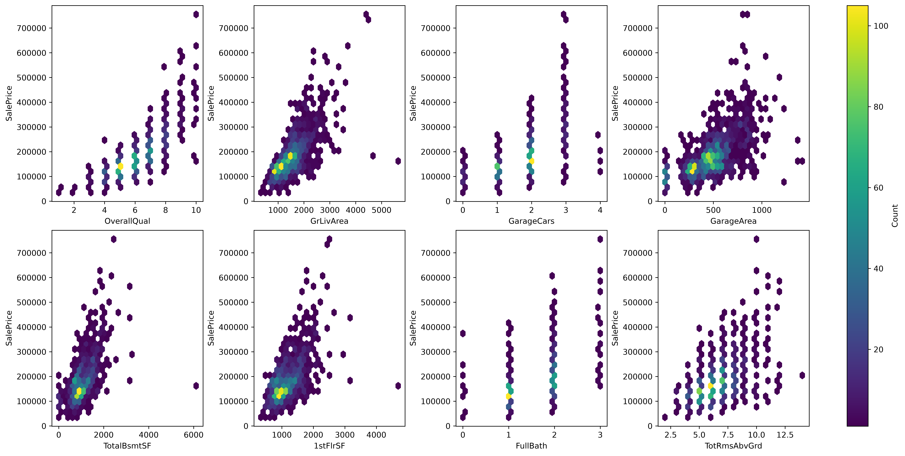                 | 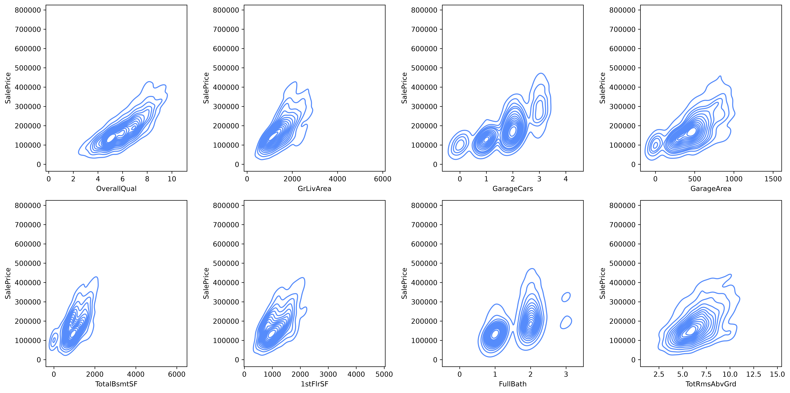                |
| 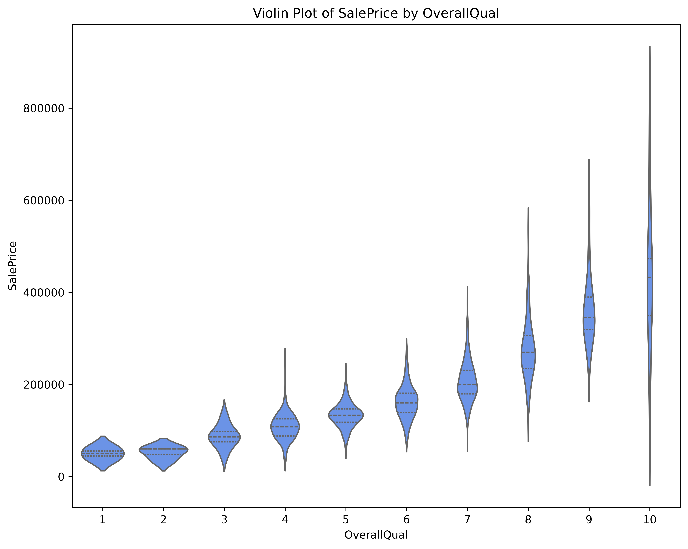 | 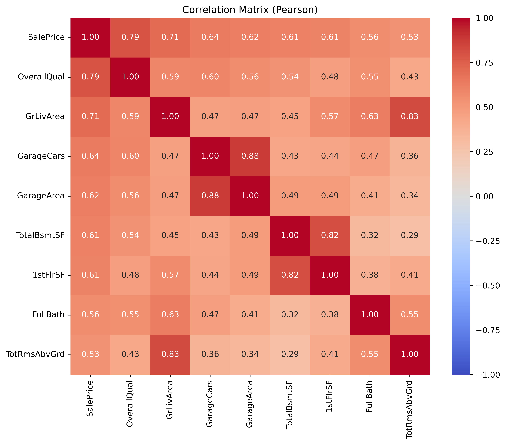        |

### Notebook 02

|                                                                                                                                                |                                                                                                                                                |
|------------------------------------------------------------------------------------------------------------------------------------------------|------------------------------------------------------------------------------------------------------------------------------------------------|
| 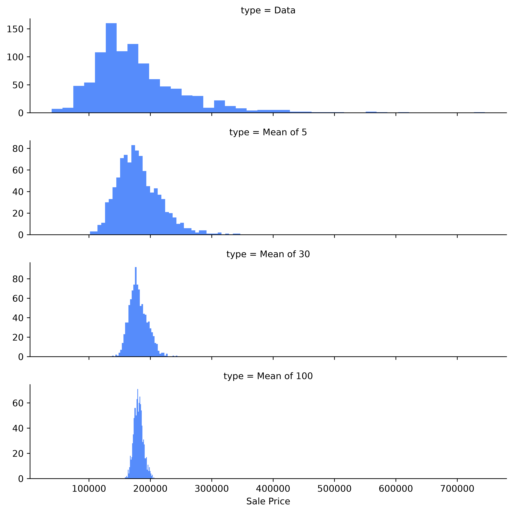                                     | 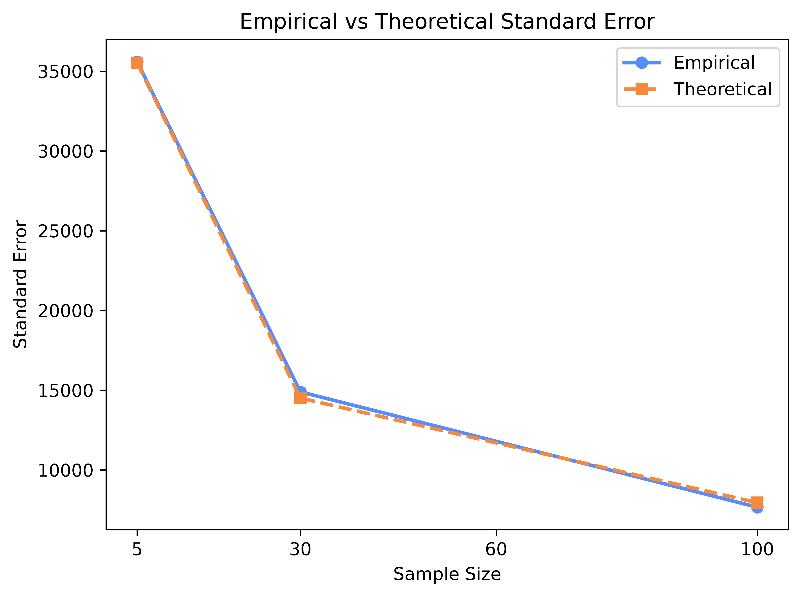                           |
| 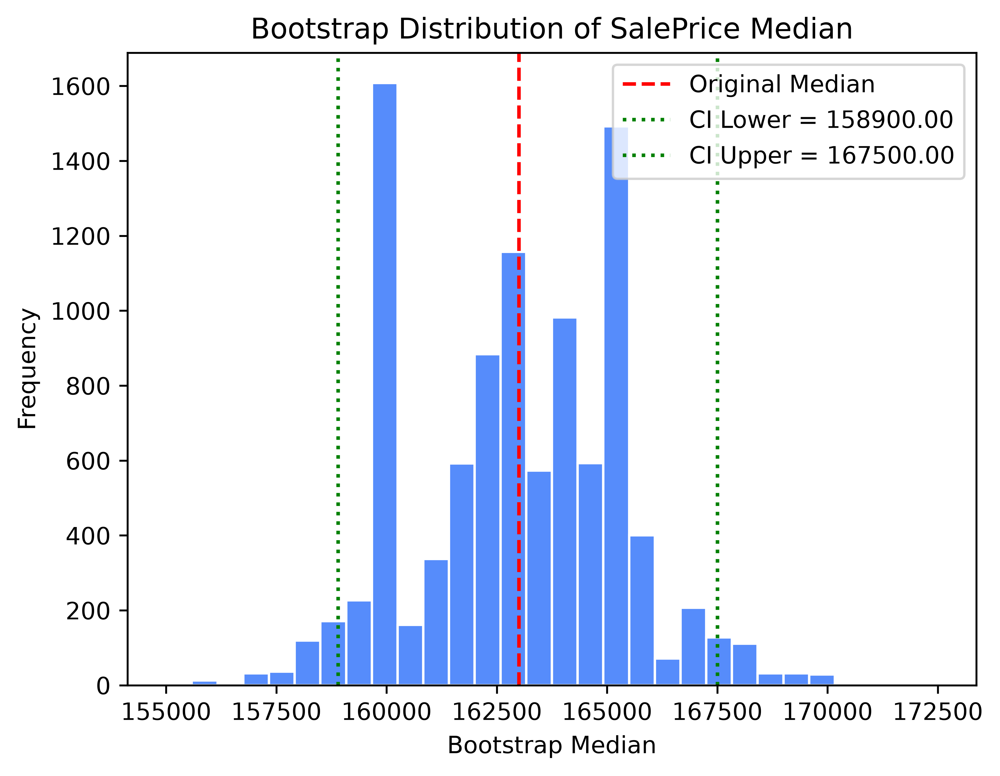          | 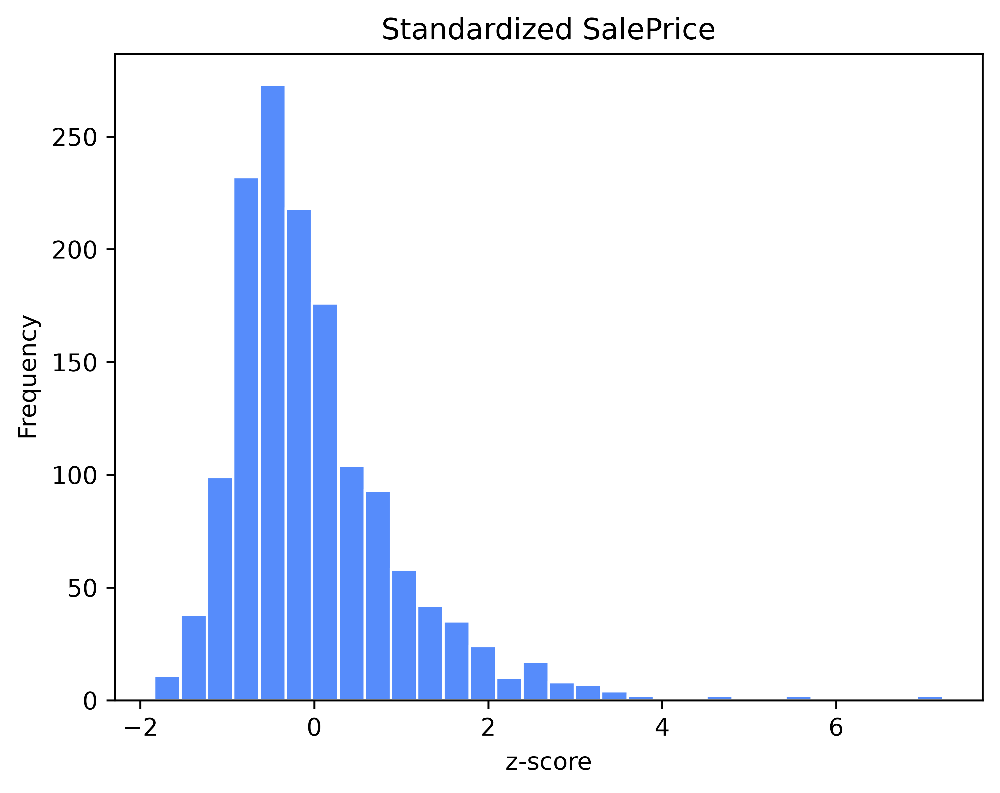                                 |
| 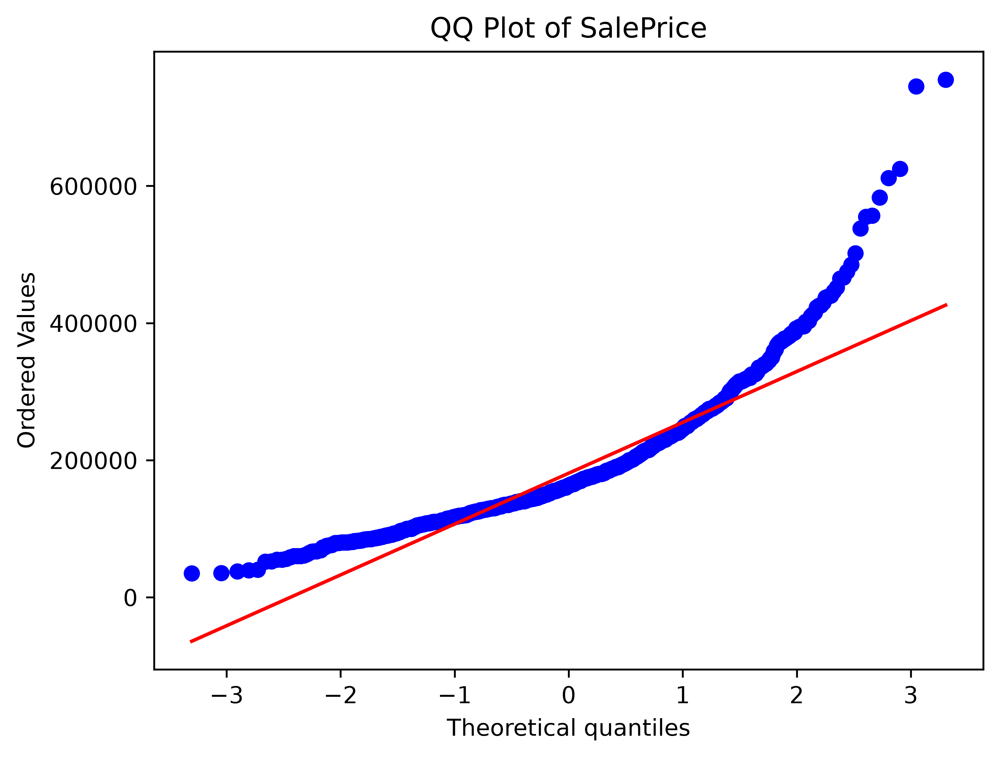                                                            | 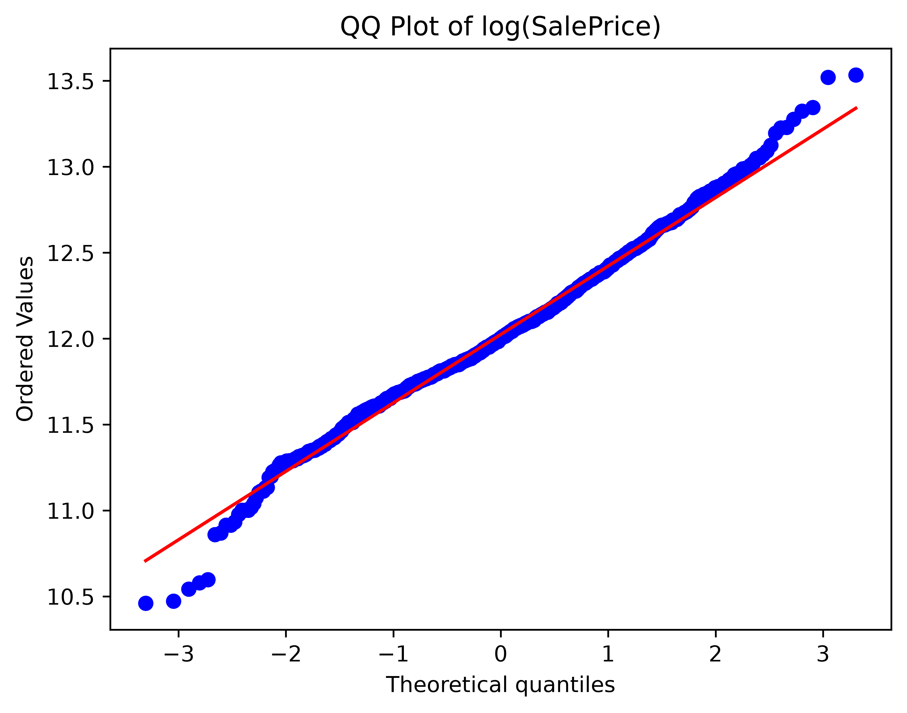                                                   |

## How to Run

```bash
# 1. Install dependencies
pip install -r requirements.txt

# 2. Launch the notebooks (run them in order; each depends on the one before it)
jupyter notebook notebooks/01_exploratory_data_analysis.ipynb
jupyter notebook notebooks/02_data_and_sampling_distributions.ipynb
```

Run the cells top to bottom. The dataset is fetched automatically via `sklearn.datasets.fetch_openml`, so no manual download is needed. The notebooks write the cleaned dataset to `data/cleaned_data.csv` and save all figures under `figures/01_exploratory_data_analysis/` and `figures/02_data_and_sampling_distributions/`. Paths are relative to the `notebooks/` directory, so run them from there (the default for Jupyter).

**Outputs of notebook 01:**

- `data/cleaned_data.csv` — the fully imputed 1,460 × 81 dataset, ready to be loaded by the downstream notebooks.
- `figures/01_exploratory_data_analysis/` — 11 publication-quality PNGs (boxplot, histogram, log-density, numeric & categorical feature grids, scatter, hexbin, contour, violin, Pearson & Spearman matrices).

**Outputs of notebook 02 (in progress):**

- `figures/02_data_and_sampling_distributions/` — 6 publication-quality PNGs (sampling-distribution facet grid, empirical vs theoretical SE line plot, bootstrap-median histogram, standardized-`SalePrice` histogram, raw `SalePrice` QQ-plot, and log-`SalePrice` QQ-plot).
- Stdout — the bootstrap analysis also prints the original median, bootstrap median, bias, bootstrap SE, and the 95% percentile CI.

## Dataset

The **Ames Housing dataset** describes residential property sales in Ames, Iowa (2006–2010): 1,460 records with 79 explanatory features (plus `Id` and target `SalePrice`) spanning lot geometry, quality/condition ratings, room counts, garage and basement details, and sale circumstances. Loaded via OpenML (`fetch_openml(name='house_prices')`); the OpenML client is bundled inside `scikit-learn`, so no separate `openml` package is required. See `data_description.txt` for the full data dictionary.

## Skills Demonstrated

- Domain-aware **data cleaning** and a three-way missing-value strategy (categorical → `"None"`, numeric → `0`, genuine gaps → group median / mode)
- **Descriptive & inferential statistics** applied and interpreted, not just computed
- **Distribution diagnostics** and transformation (skewness, log transform)
- **Monte Carlo simulation** of sampling distributions and **empirical estimation of standard error**
- **Bootstrap resampling** for statistics with no closed-form standard error (here, the median), including bootstrap bias, SE, and percentile confidence intervals
- **Empirical vs. theoretical model checking** — comparing a simulation result against the analytical `σ/√n` curve
- **Feature selection** by correlation strength and by covering distinct property domains (location, design, transaction, zoning)
- **Data visualization** with matplotlib and seaborn (histograms, boxplots, KDE, heatmaps, annotated scatter, hexbin, contour, violin, facet grids, and line plots)
- Clear **analytical storytelling** in a reproducible notebook workflow
